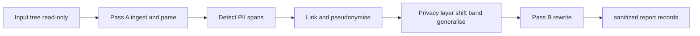

# Anamika · अनामिका

**Visible to science, invisible to attackers.**

An offline, CPU-only, LLM-free privacy firewall for India's multilingual hospital records
(English, Devanagari Hindi, Hinglish). Anamika removes personal data from messy
multi-hospital exports, including names hidden in file names, JSON keys, CSV headers,
export metadata and base64 attachments. Every medical value stays exactly as it was.
The same patient gets one keyed pseudonym across files, scripts and hospitals. The output is
generalised so that a voter-list attacker cannot single anyone out.


> **Status: Stage 0.** The safety layer, contract-correct pipeline and measuring tools are
> complete. Detection, linkage and the privacy layer arrive in S1–S4 (see
> [docs/CHANGELOG.md](docs/CHANGELOG.md)). Numbers below are measured, not projected.

## Quickstart

```bash
pip install -r requirements.txt
RAKSHA_SECRET=practice python main.py --input path/to/dev/input --output out
python3 path/to/validate_output.py --input path/to/dev/input --output out   # CONTRACT OK
```

The run needs no network. The secret is read from `RAKSHA_SECRET` only and never written
anywhere. Output: `out/sanitized/` (a mirror of the input tree, UTF-8), `out/report.json`
(every input by SHA-256 plus true counts, timing and peak memory), and `out/records.jsonl`
(record → pseudonym).

## Architecture



| Layer | Module | Role | Status |
|---|---|---|---|
| Safety | `anamika/safety.py` | PII-free logger, crash guards, HKDF keyring, AES-GCM temp | ✅ S0 |
| Ingest | `anamika/ingest/` | BOM/UTF-16/UTF-8/cp1252 decoding, JSON depth guard, CSV, quarantine | ✅ S0 |
| Detect | `anamika/detect/` | patterns + validators, column classifier, context, names, clinical safelists | baseline (S1–S3) |
| Link | `anamika/link/`, `anamika/translit/` | cross-script keys, blocking, Fellegi–Sunter, constrained clustering, HMAC pseudonyms | pseudonym primitive (S2–S4) |
| Privacy | `anamika/privacy/` | per-patient date shift, age bands, location, k-anonymity, rare-value suppression | primitives (S1–S4) |
| Rewrite | `anamika/rewrite/` | format-preserving CSV / JSON / FHIR / text writers | baseline (S1–S3) |
| Report | `anamika/report.py` | `report.json` + `records.jsonl` with counts derived from real output | ✅ S0 |

The design is detailed in [docs/ARCHITECTURE.md](docs/ARCHITECTURE.md).

## How each trap is handled

| Trap | Approach | Stage |
|---|---|---|
| Hidden leakage (file names, keys, headers, metadata, base64) | the same detector runs on every channel; HMAC-based safe file names | S1 |
| Language (EN / हिंदी / Hinglish) | Latin + Devanagari gazetteers, transliteration keys, honorific and label context | S1–S3 |
| Meaning (C/O, Dr., doses, eponyms) | clinical safelists veto PII spans; context rules tell `C/O fever` from `C/O <name>` | S3 |
| Fragmented identity | name + relative + hospital/date evidence, linked only when unique | S2–S4 |
| Re-identification | per-patient secret date shift, 5-year bands, village → district, PIN prefix, k-anonymity on rare records | S1–S4 |
| Clinical integrity | doses, vitals, labs and diagnoses never rewritten; every date of a patient shifted together, so LOS is exact | S1 |
| Robustness | content-sniffing, closed-vocabulary quarantine, linear-time depth guard, accounting check before exit 0 | ✅ S0 |

## Measured results (practice data)

| Metric | Value (S0) |
|---|---|
| Contract | CONTRACT OK; `check_submission --run` run checks all pass |
| PII still visible / medical values kept | 84.1% / 100% (starter-equivalent baseline) |
| Determinism | 195 / 195 output files byte-identical across runs |
| Secret written anywhere · temp leftovers | 0 · 0 |
| Runtime · peak RSS | 0.22 s · 29.6 MB (limits: 900 s · 4,096 MB) |

The full history is in [docs/SCORE_LOG.md](docs/SCORE_LOG.md).

## Security design

- **Keys away from data.** `RAKSHA_SECRET` → HKDF-SHA256 → independent `pseudo`, `shift`,
  `file`, `enc`, `record` keys. Pseudonyms are `PSN-` + base32 of an HMAC, never a plain hash.
- **PII-free logging.** Only whitelisted, type-checked templates can be printed (counts,
  stage names, SHA prefixes). Crashes print the exception class and stage, nothing else.
- **Encrypted at rest.** Intermediates stay in memory. Anything spilled goes to a `0700`
  directory, AES-256-GCM encrypted, and is wiped at exit, on error and on SIGTERM.
- **Fail safe.** A file is either fully parsed or quarantined with a closed-vocabulary reason.
  Nothing is copied raw, the input is opened read-only, and exit code 0 requires every input
  to be accounted for.

More detail is in [docs/SECURITY.md](docs/SECURITY.md) and [docs/PRIVACY_MODEL.md](docs/PRIVACY_MODEL.md).

## Policy knobs

All privacy settings live in [`config/policy.yaml`](config/policy.yaml): shift range,
weekday handling, age-band width and top-code, DOB policy, location targets, PIN digits,
k, quasi-identifiers, escalation order, linkage thresholds and ingest limits.
`ANAMIKA_POLICY=path.yaml` selects an alternative preset.

## Declared models

None. Anamika uses rules, regular expressions, checksums, gazetteers and keyed
cryptography only. No LLM, generative model or pretrained transformer is used at any
stage. Any small classical model added later (for example a CRF) will be trained by us,
listed here with its parameter count, and shipped in `models/`.

## Development tools

| Tool | Purpose |
|---|---|
| `tools/leak_scan.py` | scorer-style leak scan of the release and side channels; never prints values |
| `tools/determinism.py` | same-secret byte identity, secret rotation, secret/temp hygiene, input untouched |
| `tools/md2pdf.py` | renders stage overviews and the brief to PDF (`requirements-docs.txt`) |
| `pytest` | 51 unit tests on synthetic strings |

## Limitations (honest, S0)

- Detection is still at starter level, so most names, MRNs and addresses leak. S1 targets this first.
- No linkage or quasi-identifier generalisation yet, so identity and privacy scores are low.
- Unsupported formats (PDF, images, XML) are quarantined rather than parsed, by design.
- Practice data only: generalisation to unseen formats is tested from S2 with our fuzz generator.

## Repository map

`anamika/` pipeline · `config/` policy · `tools/` dev tooling · `tests/` unit tests ·
`resources/` lexicons (synthetic/public only) · `training/`, `models/` (empty: no models) ·
`dashboard/` demo console (S5, not a pipeline dependency) · `docs/` design notes and stage reports.
