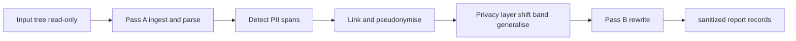

# Anamika · अनामिका

**Visible to science, invisible to attackers.**

An offline, CPU-only, LLM-free privacy firewall for India's multilingual hospital records
(English, Devanagari Hindi, Hinglish). Anamika removes personal data from messy
multi-hospital exports, including names hidden in file names, JSON keys, CSV headers,
export metadata and base64 attachments. Every medical value stays exactly as it was.
The same patient gets one keyed pseudonym across files, scripts and hospitals. The output is
generalised so that a voter-list attacker cannot single anyone out.


> **Status: Stage 5, console complete.** Detection in three scripts and every hiding place,
> cross-script linkage, measured privacy (our A1–A7 attacker, resistance 0.916), the FastAPI
> service and a six-screen Next.js console driven by live runs.


## Quickstart

Requirements: Python 3.10+, and for the service stack Docker (Docker Desktop on Windows).
`uv` is optional and is used for development.

### 1. Offline CLI (exactly what the evaluator runs)

**Linux / macOS**

```bash
python3 -m venv .venv && source .venv/bin/activate
pip install -r requirements.txt
RAKSHA_SECRET=practice python backend/main.py --input path/to/dev/input --output out
python3 path/to/validate_output.py --input path/to/dev/input --output out   # CONTRACT OK
```

**Windows (PowerShell)**

```powershell
python -m venv .venv
.venv\Scripts\Activate.ps1
pip install -r requirements.txt
$env:RAKSHA_SECRET = "practice"
python backend\main.py --input path\to\dev\input --output out
python path\to\validate_output.py --input path\to\dev\input --output out   # CONTRACT OK
```

In Command Prompt (cmd), activate with `.venv\Scripts\activate.bat` and set the secret with
`set RAKSHA_SECRET=practice`. If PowerShell blocks the activation script, run
`Set-ExecutionPolicy -Scope CurrentUser RemoteSigned` once.

Optional flags: `--debug-spans DIR` writes value-free explanations (outside `--output`), and the
`ANAMIKA_POLICY` environment variable selects a preset, e.g. `config/presets/research.yaml`.

### 2. Development with uv (pipeline + API + tests)

**Linux / macOS**

```bash
cd backend && uv sync --extra api --group docs
uv run pytest                                   # 269 tests
ANAMIKA_AUTH_DISABLED=true ANAMIKA_MASTER_SECRET=dev uv run uvicorn app.main:app --reload
```

**Windows (PowerShell)**

```powershell
powershell -ExecutionPolicy ByPass -c "irm https://astral.sh/uv/install.ps1 | iex"   # install uv once
cd backend
uv sync --extra api --group docs
uv run pytest
$env:ANAMIKA_AUTH_DISABLED = "true"; $env:ANAMIKA_MASTER_SECRET = "dev"
uv run uvicorn app.main:app --reload
```

The API docs are at http://127.0.0.1:8000/docs. On native Windows, jobs run without the Linux
resource limits (memory / CPU caps); use Docker for the enforced sandbox.

### 3. Service stack with Docker (FastAPI API + arq workers + Redis)

**Linux / macOS**

```bash
cp .env.example .env            # set master secret, API-key hashes, Redis password
docker compose up -d --build
docker compose up -d --scale worker=3
```

**Windows (PowerShell, Docker Desktop)**

```powershell
Copy-Item .env.example .env     # set master secret, API-key hashes, Redis password
docker compose up -d --build
docker compose up -d --scale worker=3
```

Generate the values for `.env` (works on every OS):

```bash
python -c "import secrets; print(secrets.token_urlsafe(48))"                       # master secret / Redis password
python -c "import hashlib,sys; print(hashlib.sha256(sys.argv[1].encode()).hexdigest())" YOUR_API_KEY
```

API reference, security controls and scaling model: [docs/API.md](docs/API.md).

The run needs no network. The secret is read from `RAKSHA_SECRET` only and never written
anywhere. Output: `out/sanitized/` (a mirror of the input tree, UTF-8), `out/report.json`
(every input by SHA-256 plus true counts, timing and peak memory), and `out/records.jsonl`
(record → pseudonym).

## Run the console

The console (`dashboard/`, Next.js) is a demo and review tool on synthetic data. It is not part of the
evaluated pipeline and not in `requirements.txt`. It needs Node.js 20+ and the backend set up with `uv sync`.

**Linux / macOS**

```bash
cd dashboard
npm install
npm run demo
```

**Windows (PowerShell)**

```powershell
cd dashboard
npm install
npm run demo
```

`npm run demo` builds once, starts FastAPI on `127.0.0.1:8001` and the console on `http://localhost:3000`, and
creates a local `.env.local` with a random API key and run secret. Datasets come from `../datasets/<name>/{input,truth,attacker}`
(override with `ANAMIKA_DATASETS_DIR`). Press **Run pipeline**; a run with the attack and the reruns takes about a minute.

| Screen | What it proves |
|---|---|
| Overview | re-identification 98% → 2%, 3,399 identifiers removed, 0 canaries, runtime and memory against the limits |
| Redaction Studio | original vs release per file; removed, generalised and deliberately kept values; Hindi and Hinglish |
| Identity Graph | 877 records → 53 patients across hospitals and scripts; same-name pairs kept apart, with the reason |
| Attack Simulator | our attacker on raw vs release per preset; measured privacy ↔ utility trade-off |
| Clinical Integrity | 98.1% clinical values kept, length of stay 34/34 exact, age bands 359/359 truthful |
| Security & Audit | leak scan per channel, byte-identical rerun, secret rotation, quarantine by SHA-256, key design |

The browser never talks to FastAPI: server-side Route Handlers hold the API key. Originals are shown only in local
demo mode (`ANAMIKA_ALLOW_ORIGINALS`), which production refuses. Five-minute walkthrough: [docs/DEMO_SCRIPT.md](docs/DEMO_SCRIPT.md).

## Architecture



Pipeline modules live in `backend/anamika/`.

| Layer | Module | Role | Status |
|---|---|---|---|
| Safety | `anamika/safety.py` | PII-free logger, crash guards, HKDF keyring, AES-GCM temp | ✅ S0 |
| Ingest | `anamika/ingest/` | BOM/UTF-16/UTF-8/cp1252 decoding, JSON depth guard, CSV, quarantine | ✅ S0 |
| Detect | `anamika/detect/` | patterns, column classifier, run-time lexicon, context engine, clinical vetoes | ✅ S1 |
| Link | `anamika/link/`, `anamika/translit/` | strong IDs + cross-script name keys with village/age/relative, cannot-link constraints, HMAC pseudonyms | ✅ S2 |
| Privacy | `anamika/privacy/` | per-patient date shift, age bands, PIN prefix, village → tehsil (k-anonymity next) | ✅ S1 |
| Rewrite | `anamika/pipeline.py`, `anamika/rewrite/` | format-preserving CSV / JSON / FHIR / text, keys, headers, metadata, base64, file names | ✅ S1 |
| Report | `anamika/report.py` | `report.json` + `records.jsonl` with counts derived from real output | ✅ S0 |
| Service | `backend/app/` | FastAPI job API, Redis store/queue, arq workers, rate limits, sandboxed runs | ✅ |

The design is detailed in [docs/ARCHITECTURE.md](docs/ARCHITECTURE.md).

## How each trap is handled

| Trap | Approach | Stage |
|---|---|---|
| Hidden leakage (file names, keys, headers, metadata, base64) | the same detector runs on every channel; HMAC-based safe file names | S1 |
| Language (EN / हिंदी / Hinglish) | Latin + Devanagari gazetteers, transliteration keys, honorific and label context | S1–S3 |
| Meaning (C/O, Dr., doses, eponyms) | clinical safelists veto PII spans; context rules tell `C/O fever` from `C/O <name>` | S3 |
| Fragmented identity | name + relative + hospital/date evidence, linked only when unique | S2–S4 |
| Re-identification | per-patient secret date shift, 5-year bands, village → district, PIN prefix, k-anonymity on rare records | S1–S4 |
| Clinical integrity | doses, vitals, labs and diagnoses never rewritten; every date of a patient shifted together, so LOS is exact | S1 |
| Robustness | content-sniffing, closed-vocabulary quarantine, linear-time depth guard, accounting check before exit 0 | ✅ S0 |

## Measured results (practice data)

| Metric | S0 baseline | S4 (balanced default) |
|---|---|---|
| PII still visible (`check_dev`): all / latin / deva / hinglish | 84.1% / 82.8 / 100 / 100% | **0.0% / 0 / 0 / 0%** |
| PII in file names, base64, metadata, keys, headers | 100% | **0%** |
| Canaries found | 4 / 4 | **0 / 4** |
| Medical values kept · non-PII words kept | 100% | **98.1%** (100% of doses, labs, vitals, diagnoses; district text generalised) · **97.4%** |
| **Attack resistance** (A1–A7, ratios to raw) | 0 | **0.914** · profile re-id 98% → 2% · targeted 82% → 27% |
| Linking precision / recall / F0.5 · false merges | 0 / 0 / 0 | **1.00 / 0.99 / 1.00 · 0** |
| **Unseen formats** (3 fuzz variants: new names, headers, labels, encodings + 13 novel templates) | n/a | **0 leaks · 100% medical · F0.5 0.99 · 0 false merges** |
| Bench, 2 pinned CPUs + 4 GB cap: 200 / 1,245 files | n/a | **2.5 s · 41 MB / 13.9 s · 59 MB** (linear) |
| Length of stay preserved | n/a | **20 / 20** |
| Determinism · other secret | identical · no change | **identical · 0 / 48 pseudonyms reused** |
| Runtime · peak RSS (limits 900 s · 4,096 MB) | 0.22 s · 30 MB | **2.6 s · 31 MB** |

Practice data is what we tuned on; the fuzz rows are data we did not tune on (`backend/tools/fuzz_gen.py`). The full history is in [docs/SCORE_LOG.md](docs/SCORE_LOG.md).

## Security design

The service layer adds hashed API keys, tenant isolation, Redis-backed rate limiting,
upload and path guards, hardening headers, sandboxed no-egress workers and hardened
containers. See [docs/API.md](docs/API.md#security-controls). The pipeline itself:

- **Keys away from data.** `RAKSHA_SECRET` → HKDF-SHA256 → independent `pseudo`, `shift`,
  `file`, `enc`, `record` keys. Pseudonyms are `PSN-` + base32 of an HMAC, never a plain hash.
- **PII-free logging.** Only whitelisted, type-checked templates can be printed (counts,
  stage names, SHA prefixes). Crashes print the exception class and stage, nothing else.
- **Encrypted at rest.** Intermediates stay in memory. Anything spilled goes to a `0700`
  directory, AES-256-GCM encrypted, and is wiped at exit, on error and on SIGTERM.
- **Fail safe.** A file is either fully parsed or quarantined with a closed-vocabulary reason.
  Nothing is copied raw, the input is opened read-only, and exit code 0 requires every input
  to be accounted for.

More detail is in [docs/SECURITY.md](docs/SECURITY.md) and [docs/PRIVACY_MODEL.md](docs/PRIVACY_MODEL.md).

## Policy knobs and presets

All privacy settings live in [`config/policy.yaml`](config/policy.yaml): shift range,
weekday handling, age-band width and top-code, DOB policy, location targets, PIN digits,
k, quasi-identifiers, escalation order, linkage thresholds and ingest limits.
`ANAMIKA_POLICY=path.yaml` selects an alternative preset. `config/presets/` ships three measured
presets: `research` (tehsil, 5-year bands, resistance 0.627), `balanced` (default, state, 10-year bands, no DOB,
0.914) and `strict` (20-year bands, rare conditions → ICD chapter, 0.917). See [docs/PRIVACY_MODEL.md](docs/PRIVACY_MODEL.md).

## Declared models

None. Anamika uses rules, regular expressions, checksums, gazetteers and keyed
cryptography only. No LLM, generative model or pretrained transformer is used at any
stage. Any small classical model added later (for example a CRF) will be trained by us,
listed here with its parameter count, and shipped in `models/`.

## Development tools

| Tool | Purpose |
|---|---|
| `backend/tools/leak_scan.py` | scorer-style leak scan of the release and side channels; never prints values |
| `backend/tools/determinism.py` | same-secret byte identity, secret rotation, secret/temp hygiene, input untouched |
| `backend/tools/fuzz_gen.py` | unseen-format variants with a consistent answer key (scored by `check_dev.py --truth`) |
| `backend/tools/bench.sh` | wall time and peak RSS under 2 pinned CPUs and a 4 GB cap |
| `backend/tools/attacker.py` | A1–A7 attack arena on raw vs release (privacy measurement) |
| `backend/tools/utility_check.py` | preserve-probes by kind and token retention (over-redaction detector) |
| `--debug-spans DIR` | value-free span / role / rule explanations per file, outside the release |
| `backend/tools/md2pdf.py` | renders stage overviews and the brief to PDF (uv group `docs`) |
| `uv run pytest` | 269 tests: pipeline units on synthetic strings + API security and job lifecycle |

## Repository map

```
anamika/
├── raksha.toml            evaluator entry (python backend/main.py)
├── requirements.txt       evaluator deps → backend/requirements.txt (exported from uv.lock)
├── config/policy.yaml     every privacy knob
├── docker-compose.yml     API + workers + Redis, hardened
├── backend/               uv project
│   ├── main.py            offline CLI entry
│   ├── anamika/           the pipeline (safety, ingest, detect, link, privacy, rewrite, report)
│   ├── app/               FastAPI service (core/, api/routes/, services/, worker.py)
│   ├── tools/             leak scan, determinism, md2pdf
│   ├── tests/             pipeline + API tests
│   └── resources/ training/ models/   lexicons; no models
├── dashboard/             Next.js console (demo and review only; npm run demo)
└── docs/                  design notes, ADRs, API, stage reports
```

## Contributors

| | Name | GitHub |
|---|---|---|
|  | Aashrith M P | [@ampere207](https://github.com/ampere207) |
|  | Rishi Navroop | [@rishinavroop22](https://github.com/rishinavroop22) |
|  | Prasad A M | [@am-prasad](https://github.com/am-prasad) |

Built for Yugaantar DevForge, Track 3 "Secret Wards".
