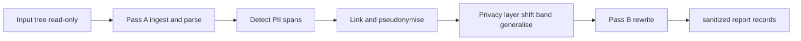

# Anamika · अनामिका

**Visible to science, invisible to attackers.**

An offline, CPU-only, LLM-free privacy firewall for India's multilingual hospital records
(English, Devanagari Hindi, Hinglish). Anamika removes personal data from messy
multi-hospital exports, including names hidden in file names, JSON keys, CSV headers,
export metadata and base64 attachments. Every medical value stays exactly as it was.
The same patient gets one keyed pseudonym across files, scripts and hospitals. The output is
generalised so that a voter-list attacker cannot single anyone out.


> **Status: Stage 2 (`v1-safe`).** Detection in three scripts and every hiding place, cross-script
> linkage, per-patient date shifting and generalisation are live and fuzz-tested on unseen formats. k-anonymity and the measured attack arrive
> in S4 (see [docs/CHANGELOG.md](docs/CHANGELOG.md)). Numbers below are measured, not projected.

## Quickstart

**Offline CLI** (exactly what the evaluator runs; pipeline-only dependencies):

```bash
pip install -r requirements.txt
RAKSHA_SECRET=practice python backend/main.py --input path/to/dev/input --output out
python3 path/to/validate_output.py --input path/to/dev/input --output out   # CONTRACT OK
```

**Development with uv** (pipeline + API + tests):

```bash
cd backend && uv sync --extra api --group docs
uv run pytest                                   # 77 tests
ANAMIKA_AUTH_DISABLED=true ANAMIKA_MASTER_SECRET=dev uv run uvicorn app.main:app --reload
```

**Service stack with Docker** (FastAPI API + arq workers + Redis):

```bash
cp .env.example .env            # set master secret, API-key hashes, Redis password
docker compose up -d --build
docker compose up -d --scale worker=3
```

API reference, security controls and scaling model: [docs/API.md](docs/API.md).

The run needs no network. The secret is read from `RAKSHA_SECRET` only and never written
anywhere. Output: `out/sanitized/` (a mirror of the input tree, UTF-8), `out/report.json`
(every input by SHA-256 plus true counts, timing and peak memory), and `out/records.jsonl`
(record → pseudonym).

## Architecture



Pipeline modules live in `backend/anamika/`.

| Layer | Module | Role | Status |
|---|---|---|---|
| Safety | `anamika/safety.py` | PII-free logger, crash guards, HKDF keyring, AES-GCM temp | ✅ S0 |
| Ingest | `anamika/ingest/` | BOM/UTF-16/UTF-8/cp1252 decoding, JSON depth guard, CSV, quarantine | ✅ S0 |
| Detect | `anamika/detect/` | patterns, column classifier, run-time lexicon, context engine, clinical vetoes | ✅ S1 |
| Link | `anamika/link/`, `anamika/translit/` | strong IDs + cross-script name keys with village/age/relative, cannot-link constraints, HMAC pseudonyms | ✅ S2 |
| Privacy | `anamika/privacy/` | per-patient date shift, age bands, PIN prefix, village → tehsil (k-anonymity next) | ✅ S1 |
| Rewrite | `anamika/pipeline.py`, `anamika/rewrite/` | format-preserving CSV / JSON / FHIR / text, keys, headers, metadata, base64, file names | ✅ S1 |
| Report | `anamika/report.py` | `report.json` + `records.jsonl` with counts derived from real output | ✅ S0 |
| Service | `backend/app/` | FastAPI job API, Redis store/queue, arq workers, rate limits, sandboxed runs | ✅ |

The design is detailed in [docs/ARCHITECTURE.md](docs/ARCHITECTURE.md).

## How each trap is handled

| Trap | Approach | Stage |
|---|---|---|
| Hidden leakage (file names, keys, headers, metadata, base64) | the same detector runs on every channel; HMAC-based safe file names | S1 |
| Language (EN / हिंदी / Hinglish) | Latin + Devanagari gazetteers, transliteration keys, honorific and label context | S1–S3 |
| Meaning (C/O, Dr., doses, eponyms) | clinical safelists veto PII spans; context rules tell `C/O fever` from `C/O <name>` | S3 |
| Fragmented identity | name + relative + hospital/date evidence, linked only when unique | S2–S4 |
| Re-identification | per-patient secret date shift, 5-year bands, village → district, PIN prefix, k-anonymity on rare records | S1–S4 |
| Clinical integrity | doses, vitals, labs and diagnoses never rewritten; every date of a patient shifted together, so LOS is exact | S1 |
| Robustness | content-sniffing, closed-vocabulary quarantine, linear-time depth guard, accounting check before exit 0 | ✅ S0 |

## Measured results (practice data)

| Metric | S0 baseline | S2 (`v1-safe`) |
|---|---|---|
| PII still visible (`check_dev`): all / latin / deva / hinglish | 84.1% / 82.8 / 100 / 100% | **0.0% / 0 / 0 / 0%** |
| PII in file names, base64, metadata, keys, headers | 100% | **0%** |
| Canaries found | 4 / 4 | **0 / 4** |
| Medical values kept | 100% | **100%** (4,855 / 4,855) |
| Linking precision / recall / F0.5 · false merges | 0 / 0 / 0 | **1.00 / 0.99 / 1.00 · 0** |
| **Unseen formats** (3 fuzz variants: new names, headers, labels, encodings, templates) | n/a | **0 leaks · 100% medical · F0.5 0.99 · 0 false merges** |
| Bench, 2 pinned CPUs + 4 GB cap: 200 / 1,245 files | n/a | **2.6 s · 43 MB / 20.4 s · 63 MB** |
| Length of stay preserved | n/a | **20 / 20** |
| Determinism · other secret | identical · no change | **identical · 0 / 48 pseudonyms reused** |
| Runtime · peak RSS (limits 900 s · 4,096 MB) | 0.22 s · 30 MB | **2.6 s · 31 MB** |

Practice data is what we tuned on; the fuzz rows are data we did not tune on (`backend/tools/fuzz_gen.py`). The full history is in [docs/SCORE_LOG.md](docs/SCORE_LOG.md).

## Security design

The service layer adds hashed API keys, tenant isolation, Redis-backed rate limiting,
upload and path guards, hardening headers, sandboxed no-egress workers and hardened
containers. See [docs/API.md](docs/API.md#security-controls). The pipeline itself:

- **Keys away from data.** `RAKSHA_SECRET` → HKDF-SHA256 → independent `pseudo`, `shift`,
  `file`, `enc`, `record` keys. Pseudonyms are `PSN-` + base32 of an HMAC, never a plain hash.
- **PII-free logging.** Only whitelisted, type-checked templates can be printed (counts,
  stage names, SHA prefixes). Crashes print the exception class and stage, nothing else.
- **Encrypted at rest.** Intermediates stay in memory. Anything spilled goes to a `0700`
  directory, AES-256-GCM encrypted, and is wiped at exit, on error and on SIGTERM.
- **Fail safe.** A file is either fully parsed or quarantined with a closed-vocabulary reason.
  Nothing is copied raw, the input is opened read-only, and exit code 0 requires every input
  to be accounted for.

More detail is in [docs/SECURITY.md](docs/SECURITY.md) and [docs/PRIVACY_MODEL.md](docs/PRIVACY_MODEL.md).

## Policy knobs

All privacy settings live in [`config/policy.yaml`](config/policy.yaml): shift range,
weekday handling, age-band width and top-code, DOB policy, location targets, PIN digits,
k, quasi-identifiers, escalation order, linkage thresholds and ingest limits.
`ANAMIKA_POLICY=path.yaml` selects an alternative preset.

## Declared models

None. Anamika uses rules, regular expressions, checksums, gazetteers and keyed
cryptography only. No LLM, generative model or pretrained transformer is used at any
stage. Any small classical model added later (for example a CRF) will be trained by us,
listed here with its parameter count, and shipped in `models/`.

## Development tools

| Tool | Purpose |
|---|---|
| `backend/tools/leak_scan.py` | scorer-style leak scan of the release and side channels; never prints values |
| `backend/tools/determinism.py` | same-secret byte identity, secret rotation, secret/temp hygiene, input untouched |
| `backend/tools/fuzz_gen.py` | unseen-format variants with a consistent answer key (scored by `check_dev.py --truth`) |
| `backend/tools/bench.sh` | wall time and peak RSS under 2 pinned CPUs and a 4 GB cap |
| `backend/tools/md2pdf.py` | renders stage overviews and the brief to PDF (uv group `docs`) |
| `uv run pytest` | 224 tests: pipeline units on synthetic strings + API security and job lifecycle |

## Limitations (honest, S2)

- Fuzz variants reuse the practice templates (plus three novel ones), so the organisers' chaos round can still surprise.
- Phonetic name keys can collide for short names; they are used only with a second clue and under cannot-link constraints.
- No k-anonymity escalation or measured re-identification risk yet; rare diagnoses and very old ages remain exposed to the targeted attack (S4).
- Unsupported formats (PDF, images, XML) and invalid-UTF-8 notes are quarantined rather than parsed, by design.

## Repository map

```
anamika/
├── raksha.toml            evaluator entry (python backend/main.py)
├── requirements.txt       evaluator deps → backend/requirements.txt (exported from uv.lock)
├── config/policy.yaml     every privacy knob
├── docker-compose.yml     API + workers + Redis, hardened
├── backend/               uv project
│   ├── main.py            offline CLI entry
│   ├── anamika/           the pipeline (safety, ingest, detect, link, privacy, rewrite, report)
│   ├── app/               FastAPI service (core/, api/routes/, services/, worker.py)
│   ├── tools/             leak scan, determinism, md2pdf
│   ├── tests/             pipeline + API tests
│   └── resources/ training/ models/   lexicons; no models
├── frontend/              Next.js console (not started)
└── docs/                  design notes, ADRs, API, stage reports
```
