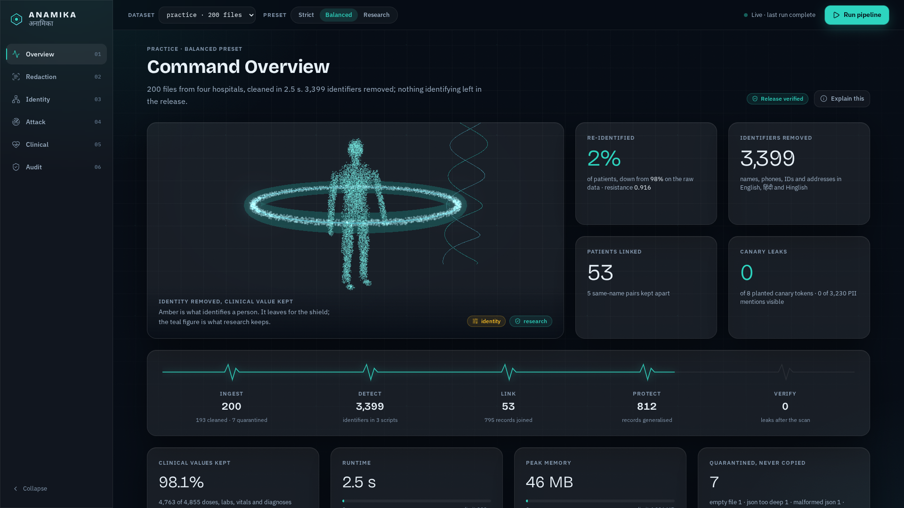
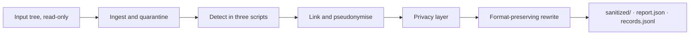

<div align="center">

# Anamika · अनामिका

### Visible to science, invisible to attackers.

**An offline, CPU-only, LLM-free privacy firewall for India's multilingual hospital records.**

[](https://github.com/ampere207/Anamika/actions/workflows/ci.yml)


</div>

Indian hospitals export patient data as a tangle of CSV registers, nested JSON, FHIR bundles and free-text notes written in
English, Devanagari Hindi and Hinglish. Anamika turns that export into a research-ready release:

- **every personal identifier is removed**, including the ones hidden in file names, JSON keys, CSV headers, export metadata and
  base64 attachments;
- **every clinical value stays exact**: doses, frequencies, vitals, lab results, diagnoses, procedures and treating doctors;
- **each patient gets one keyed pseudonym** across files, hospitals and scripts, and two different people are never merged;
- **the release resists re-identification**: a voter-list attacker re-identifies 98% of patients on the raw data and 2% on ours.

It runs fully offline on two CPUs in seconds, uses no machine-learning model at all, and proves its own privacy on every run.



## Results at a glance

Measured with the organisers' `check_dev.py` and `validate_output.py` on the practice data, balanced (default) policy.

| | |
|---|---|
| **Personal data visible after cleaning** | **0 of 3,230** mentions · English 0 · Hindi 0 · Hinglish 0 |
| **Planted canary identities found** | **0** |
| **Clinical values preserved** | **98.1%** (4,763 of 4,855); 100% of doses, labs, vitals, diagnoses and procedures |
| **Patient linking** precision / recall / F0.5 | **1.00 / 0.99 / 1.00**, with **0** wrong merges |
| **Re-identification** by our voter-list attacker | **97.9% → 2.1%** of patients · attack resistance **0.916** |
| **Length of stay** · **age bands** | **34 / 34** exact to the day · **359 / 359** contain the true age |
| **Speed** (no network, 2 CPUs, 4 GB cap) | **1.9 s, 39 MB** for 200 files · **13.9 s** for 1,245 files |
| **Reproducibility** | byte-identical on rerun and across Python 3.10 / 3.12 · a new secret changes **all** pseudonyms |
| **Generalisation** (4 datasets with invented names, unseen labels and formats) | ≤ 0.03% visible · F0.5 **0.99** · **0** wrong merges · **98.1%** clinical values kept |

## What makes Anamika different

**It learns each dataset before it rewrites it.** Pass A reads every file, classifies each field by its label *and* by profiling
its values, and turns the names it finds in structured fields into a run-time lexicon. That lexicon then finds the same people in
free text, in any script and spelling: *Mohammad Arif*, *Md. Arif*, *मोहम्मद आरिफ* and *"Arif sahab ka BP 150/90"*. Pass B
rewrites with that knowledge. New names, new column labels and new formats are handled by context, not by lists.

**It understands meaning, not just patterns.** `C/O fever` is a complaint and `C/O Ramesh` is a relative. `Dr. Ramesh` stays,
`S/o Ramesh` goes. `650 mg`, `BP 109/76` and `1-0-1` are clinical values, never phone numbers or dates. Parkinson's and Crohn's
are diseases, not people.

**It attacks its own release.** A re-implementation of the published attacks (direct exposure, registry linkage, profile
re-identification, targeted attacks with known visit dates and rare conditions, pseudonym inversion, cross-release linkage) runs on
the raw data and on the release. Every privacy setting in `config/policy.yaml` was chosen on measured risk and measured clinical loss.

**It links precisely across scripts.** Strong IDs join first; names are matched through transliteration, variant folding and a
consonant skeleton, and only together with a date of birth, a village and compatible age, or a relative. Every merge is checked
against the whole cluster, so links never chain into a wrong merge.

**It is safe by construction.** One secret, four derived keys, nothing stored. Logs cannot carry data. Anything that cannot be
parsed safely is quarantined, never copied.

## Submission compliance

| Requirement | Where | Verified |
|---|---|---|
| Public GitHub repository | this repository | public |
| `raksha.toml` at the root | [raksha.toml](raksha.toml) | team `anamika` · `pip install -r requirements.txt` · `python main.py --input {input} --output {output}` |
| `requirements.txt` | [requirements.txt](requirements.txt) | pinned pure-Python wheels, no LLM packages, installs in about 15 s |
| `config/policy.yaml` | [config/policy.yaml](config/policy.yaml) | every privacy rule; measured presets in `config/presets/` |
| `main.py` | [main.py](main.py) → [backend/anamika](backend/anamika) | main execution pipeline |
| 2-page Project Brief | [Anamika_Project_Brief.pdf](Anamika_Project_Brief.pdf) | A4, two pages, 10 pt and above |
| `sanitized/`, `report.json`, `records.jsonl` | written to `{output}` | **CONTRACT OK** |
| Offline · 2 CPUs · 4 GB · 15 minutes | tested in a no-network namespace with `taskset -c 0,1` and a 4 GB memory cap | 1.9 s · 39 MB |
| No LLMs or transformers above 50M parameters | rules, checksums, context and classical record linkage | no model of any kind |
| Same input and secret → identical output | keyed HMAC pseudonyms and keyed date shifts | identical; a different secret changes the output |
| `check_submission.py --repo . --run` | on a fresh clone in a fresh virtual environment | **READY TO SUBMIT** |

## Quickstart

### Run the pipeline (what the evaluator runs)

Python 3.10 or newer. No network is needed at run time.

**Linux / macOS**

```bash
python3 -m venv .venv && source .venv/bin/activate
pip install -r requirements.txt
RAKSHA_SECRET=your-secret python main.py --input path/to/dev/input --output out
python3 path/to/validate_output.py --input path/to/dev/input --output out    # CONTRACT OK
```

**Windows (PowerShell)**

```powershell
python -m venv .venv
.venv\Scripts\Activate.ps1
pip install -r requirements.txt
$env:RAKSHA_SECRET = "your-secret"
python main.py --input path\to\dev\input --output out
python path\to\validate_output.py --input path\to\dev\input --output out    # CONTRACT OK
```

In Command Prompt, activate with `.venv\Scripts\activate.bat` and use `set RAKSHA_SECRET=your-secret`. If PowerShell blocks the
activation script, run `Set-ExecutionPolicy -Scope CurrentUser RemoteSigned` once.

The output folder holds `sanitized/` (the input tree mirrored, same formats, UTF-8), `report.json` (every input file by SHA-256,
true counts, timing and peak memory) and `records.jsonl` (each record and its pseudonym). Two options help review:
`--debug-spans DIR` writes value-free explanations of every decision outside the release, and `ANAMIKA_POLICY` selects a preset,
for example `config/presets/research.yaml`.

### Run the console

The Anamika Console shows one live run end to end. It is a review tool and is not part of the evaluated pipeline.
It needs Node.js 20+ and the backend environment (`cd backend && uv sync --all-extras`).

```bash
cd dashboard
npm install
npm run demo
```

`npm run demo` starts the FastAPI service on `127.0.0.1:8001` and the console on `http://localhost:3000`. Place datasets under
`datasets/<name>/{input,truth,attacker}` at the repository root (or set `ANAMIKA_DATASETS_DIR`) and press **Run pipeline**.

| Screen | What it shows |
|---|---|
| **Command Overview** | re-identification 98% → 2%, identifiers removed, patients linked, canaries, runtime and memory against the limits |
| **Redaction Studio** | original and release side by side; removed, generalised and deliberately kept values; English, Hindi and Hinglish |
| **Identity Graph** | 877 records resolving to 53 patients across hospitals and scripts; same-name pairs kept apart, with the reason |
| **Attack Simulator** | the attacker on raw data and release for each policy preset; the measured privacy ↔ utility trade-off |
| **Clinical Integrity** | clinical values kept by kind, length of stay before and after, age-band truthfulness |
| **Security & Audit** | leak scan per channel, byte-identical rerun, secret rotation, quarantine by SHA-256, key design |

The browser never talks to the pipeline service directly: server-side route handlers hold the API key.

### Run the service stack (FastAPI, workers, Redis)

```bash
cp .env.example .env            # master secret, API-key hashes, Redis password
docker compose up -d --build
docker compose up -d --scale worker=3
```

On Windows use `Copy-Item .env.example .env` with Docker Desktop. Generate values with
`python -c "import secrets; print(secrets.token_urlsafe(48))"`. API reference, security controls and scaling model:
[docs/API.md](docs/API.md).

### Develop

```bash
cd backend && uv sync --all-extras
uv run pytest                    # 274 tests: pipeline, privacy, linkage and API security
```

## Architecture



| Layer | Module | What it does |
|---|---|---|
| Safety | `backend/anamika/safety.py` | PII-free logger, content-free crash handling, HKDF keyring, AES-GCM encrypted temp space |
| Ingest | `backend/anamika/ingest/` | format sniffing by content; UTF-8/16, cp1252, Latin-1; CSV/TSV, JSON, NDJSON, FHIR R4, text; depth and size guards |
| Detect | `backend/anamika/detect/` | checksummed patterns, field classifier with value profiling, run-time lexicon, context engine, clinical vetoes |
| Link | `backend/anamika/link/`, `translit/` | strong-ID union-find, cross-script phonetic keys, Fellegi–Sunter gate, cannot-link constraints, HMAC pseudonyms |
| Privacy | `backend/anamika/privacy/` | per-patient date shift, truthful age bands, location generalisation, PIN and DOB policy, optional rare-value suppression |
| Rewrite | `backend/anamika/pipeline.py`, `rewrite/` | format-preserving CSV, JSON, FHIR and text; keys, headers, metadata, base64 attachments and file names |
| Report | `backend/anamika/report.py` | `report.json` and `records.jsonl` with every count derived from the actual output |
| Service | `backend/app/` | FastAPI job API, Redis queue, arq workers, rate limits, sandboxed pipeline runs |
| Console | `dashboard/` | Next.js review console over live runs |

The full design is in [docs/ARCHITECTURE.md](docs/ARCHITECTURE.md).

## How every challenge is handled

| Challenge | How Anamika solves it |
|---|---|
| **Hidden leakage**: file names, JSON keys, CSV headers, metadata, base64 | the same detector runs on every channel; files with PII in the name get HMAC-derived safe names |
| **Three scripts**: English, हिंदी, Hinglish | Devanagari and Latin context rules, transliteration keys, Hinglish particles and honorifics (*ji, sahab, didi*) |
| **Indian identifiers** | Verhoeff-checked Aadhaar, PAN, ABHA number and address, voter ID, UHID/IPD/MRN by label, phones in any spacing or Devanagari digits |
| **Meaning traps** | clinical safelists veto PII spans; context separates complaints from relatives and doctors from family |
| **Unseen labels and formats** | fields are classified by profiling their values, so a column called anything is still recognised |
| **Fragmented identity** | name with a relative, a village and age, or a date of birth; a link is made only when exactly one candidate fits |
| **Same name, different people** | cannot-link constraints on conflicting IDs, sex and age, checked against the whole cluster |
| **Re-identification** | per-patient keyed date shift, DOB removed, 10-year age bands, location raised to state, PIN removed |
| **Clinical integrity** | clinical values are never rewritten; all of a patient's dates move together, so every interval is exact |
| **Broken and unsupported files** | content sniffing, closed-vocabulary quarantine reasons, nothing copied raw, every input accounted for |

## Privacy model

Every rule lives in [`config/policy.yaml`](config/policy.yaml): date-shift range and weekday handling, age-band width and top code,
DOB policy, location level, PIN digits, quasi-identifiers, linkage thresholds and ingest limits. Three presets ship in
`config/presets/`, each measured end to end with the attacker and the clinical probes:

| Preset | Location · age band | Attack resistance | Patients re-identified | Clinical values kept |
|---|---|---|---|---|
| `research` | tehsil · 5 years | 0.612 | 89.6% | 100% |
| **`balanced`** (default) | **state · 10 years** | **0.916** | **2.1%** | **98.1%** |
| `strict` | state · 20 years, rare values suppressed | 0.920 | 2.1% | 97.4% |

The balanced default keeps every dose, lab value, vital, diagnosis, procedure and interval, and gives up only location detail
below state level. Attack by attack, raw data → release:

| Attack | Raw | Release |
|---|---|---|
| Direct exposure (a surviving ID or full name) | 100% | 2.1% |
| Registry linkage on a voter list | 66.7% | 4.1% |
| Profile re-identification | 97.9% | 2.1% |
| Global date shift recovered | yes | no |
| Pseudonyms reversed · kept under a new secret | n/a | 0 · 0 |

More in [docs/PRIVACY_MODEL.md](docs/PRIVACY_MODEL.md).

## Security design

- **Keys away from data.** `RAKSHA_SECRET` is read from the environment only. HKDF-SHA256 derives independent keys for
  pseudonyms, date shifts, file names and temp encryption. Pseudonyms are `PSN-` plus an HMAC, never a plain hash.
- **Logs that cannot carry data.** Only whitelisted, type-checked templates can be printed: counts, stage names, hash prefixes.
  Crashes print the exception type and stage, never a value or a traceback.
- **Encrypted at rest.** Intermediates stay in memory; anything spilled goes to a private `0700` directory, AES-256-GCM
  encrypted, and is wiped at exit, on error and on SIGTERM.
- **Fail closed.** A file is fully sanitised or quarantined with a reason. The input is opened read-only, and the run exits 0
  only when every input file is accounted for.
- **Service hardening.** Hashed API keys, tenant isolation, Redis-backed rate limits, upload and path guards, security headers,
  sandboxed no-egress workers and non-root containers.
- **Breach-resistant.** A copy of the release contains no key: pseudonyms and date offsets cannot be reversed without the secret,
  and rotating the secret changes all of them.

More in [docs/SECURITY.md](docs/SECURITY.md).

## Declared models

**None.** Anamika uses rules, regular expressions, checksums, context analysis, classical record linkage and keyed cryptography.
No LLM, generative model or pretrained transformer is used anywhere, and nothing is downloaded at run time.

## Verification tooling

| Tool | Purpose |
|---|---|
| `backend/tools/leak_scan.py` | scorer-style scan of the release and every side channel (logs, temp files, report); never prints values |
| `backend/tools/attacker.py` | the six attacks on raw data and release, risk reported as the organisers score it |
| `backend/tools/utility_check.py` | clinical probes by kind, length of stay, age-band truthfulness and text retention |
| `backend/tools/fuzz_gen.py` | generates never-seen datasets with invented names, unseen labels, new formats and broken files |
| `backend/tools/determinism.py` | byte-identical reruns, secret rotation, secret and temp hygiene, input left untouched |
| `backend/tools/bench.sh` | wall time and peak memory on two pinned CPUs with a 4 GB cap |
| `.github/workflows/ci.yml` | the test suite plus the organisers' `validate_output.py` and `check_submission.py` on Python 3.10 and 3.12 |

## Documentation

| Document | Contents |
|---|---|
| [Anamika_Project_Brief.pdf](Anamika_Project_Brief.pdf) | the two-page project brief |
| [docs/ARCHITECTURE.md](docs/ARCHITECTURE.md) | components, data flow, the two passes, security boundaries |
| [docs/DETECTION.md](docs/DETECTION.md) | detectors, context rules and the meaning traps |
| [docs/LINKAGE.md](docs/LINKAGE.md) | cross-script keys, scoring, clustering without wrong merges |
| [docs/PRIVACY_MODEL.md](docs/PRIVACY_MODEL.md) | threat model, quasi-identifiers, date shift, measured risk |
| [docs/SECURITY.md](docs/SECURITY.md) | key handling, logging, temp encryption, quarantine |
| [docs/API.md](docs/API.md) | the FastAPI service, security controls and scaling |
| [docs/DECISIONS.md](docs/DECISIONS.md) | design decisions with the alternatives considered |
| [docs/DESIGN_SYSTEM.md](docs/DESIGN_SYSTEM.md) | the console's design system |

## Repository map

```
Anamika/
├── raksha.toml                 evaluator entry: python main.py --input {input} --output {output}
├── main.py                     main execution entry → backend/anamika
├── requirements.txt            pipeline dependencies (exported from backend/uv.lock)
├── config/                     policy.yaml and measured presets
├── Anamika_Project_Brief.pdf   two-page project brief
├── backend/
│   ├── anamika/                the pipeline: safety, ingest, detect, link, privacy, rewrite, report
│   ├── app/                    FastAPI service and workers
│   ├── tools/                  leak scan, attacker, utility check, fuzz generator, determinism, bench
│   ├── tests/                  274 tests
│   └── resources/              lexicons (synthetic and public lists only)
├── dashboard/                  Anamika Console (Next.js)
├── docker-compose.yml          API, workers and Redis
└── docs/                       design documentation
```

## Contributors

| | Name | GitHub |
|---|---|---|
|  | Aashrith M P | [@ampere207](https://github.com/ampere207) |
|  | Rishi Navroop | [@rishinavroop22](https://github.com/rishinavroop22) |
|  | Prasad A M | [@am-prasad](https://github.com/am-prasad) |

Built for Yugaantar DevForge · Track 3 · Secret Wards.
