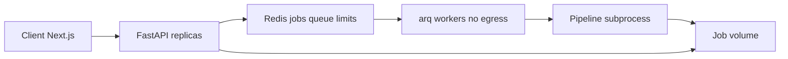

# Anamika API (FastAPI service layer)

The service exposes the offline pipeline as an authenticated, rate-limited job API.
It never re-implements the pipeline. Each job runs exactly the command the evaluator runs
(`python main.py --input … --output …`) in a sandboxed subprocess, so service output is
byte-identical to CLI output.



## Run it

```bash
# local, single process (inline queue, in-memory store)
cd backend && uv sync --extra api
ANAMIKA_AUTH_DISABLED=true ANAMIKA_MASTER_SECRET=dev uv run uvicorn app.main:app --reload

# full stack (API + workers + Redis), from the repo root
cp .env.example .env    # fill in secrets
docker compose up -d --build
docker compose up -d --scale worker=3
```

Interactive docs are served at `/docs` outside production.

## Endpoints

| Method | Path | Purpose | Rate bucket |
|---|---|---|---|
| GET | `/healthz` | liveness | none |
| GET | `/readyz` | store, storage and secret readiness (503 if not ready) | none |
| GET | `/api/v1/policy` | active privacy policy (`config/policy.yaml`) | default |
| GET | `/api/v1/datasets` | allow-listed server-side datasets | default |
| POST | `/api/v1/jobs` | multipart upload (`files` parts, filename = relative path; `release`, `verify_determinism`, `leak_scan`) → 202 | jobs-create |
| POST | `/api/v1/jobs/from-dataset` | JSON `{dataset, release, verify_determinism, leak_scan}` → 202 | jobs-create |
| GET | `/api/v1/jobs` | caller's jobs | default |
| GET | `/api/v1/jobs/{id}` | status, counts, quarantine reasons, timing, verification | default |
| GET | `/api/v1/jobs/{id}/report` | `report.json` | default |
| GET | `/api/v1/jobs/{id}/records?offset&limit` | paginated `records.jsonl` | default |
| GET | `/api/v1/jobs/{id}/files` | sanitised files with size and SHA-256 | default |
| GET | `/api/v1/jobs/{id}/files/{path}` | one sanitised file (attachment) | downloads |
| GET | `/api/v1/jobs/{id}/archive` | release zip | downloads |
| DELETE | `/api/v1/jobs/{id}` | delete job and wipe its workspace | default |

Job status moves `queued → running → succeeded | failed`. Errors are closed-vocabulary
codes (`pipeline_failed`, `pipeline_timeout`, `service_not_configured`, …).
Verification results: `determinism` (same secret, files identical), `rotation`
(rotated secret: files changed, pseudonyms reused), and `leak_scan` (only for datasets
that ship an answer key).

## Security controls

| Control | Implementation |
|---|---|
| Authentication | `X-API-Key`. The server stores only SHA-256 hashes and compares in constant time. Production refuses to start without keys or with auth disabled |
| Tenant isolation | each job is owned by the key's principal; other callers get 404, so a job's existence is not revealed |
| Rate limiting | fixed-window per principal (or IP), Redis-backed so it holds across replicas; separate buckets for create, read and downloads; `429` with `Retry-After` and `X-RateLimit-*` |
| Abuse caps | max active jobs per principal, max request size (413), max files and fields per upload, path depth |
| Upload safety | path normalisation rejects traversal, absolute paths, control and reserved characters, and duplicates; files written `0600` in `0700` dirs; on rejection the workspace is wiped |
| Secrets | per-release `RAKSHA_SECRET = HMAC(master, owner/release)`, never stored or returned; a different tenant or release gives different pseudonyms |
| Sandboxed runs | clean env, private TMPDIR/HOME, `RLIMIT_AS`/`RLIMIT_CPU`/no core dumps, CPU affinity, wall-clock timeout; workers sit on an internal network with **no egress** |
| Data minimisation | raw uploads deleted right after the run (`retain_inputs=false`); workspaces expire (`job_ttl_hours`) via an hourly cleanup; Redis records carry the same TTL |
| HTTP hardening | TrustedHost, strict CORS allow-list (the Next.js origin), CSP `default-src 'none'`, nosniff, frame deny, no-referrer, `Cache-Control: no-store`, HSTS in production, no server header |
| Error hygiene | validation errors list field locations only (never input values); unhandled errors return `internal_error` plus a request id |
| Logging | one line per request: method, **route template**, status, duration, request id. Never concrete paths, file names or bodies |
| Containers | non-root UID 10001, read-only root FS, `cap_drop: ALL`, `no-new-privileges`, tmpfs `/tmp`, CPU/memory limits, health checks; Redis password-protected on an internal network with dangerous commands disabled |

## Scaling model

API replicas are stateless: job metadata and rate-limit counters live in Redis, files on
a shared volume. Throughput scales with `docker compose up --scale worker=N`. Each worker
runs `WORKER_CONCURRENCY` jobs, each limited to 2 CPUs and 4 GB (the evaluation budget).
For multi-host deployments, swap the named volume for shared or object storage and Redis
for a managed instance. Nothing else changes.
