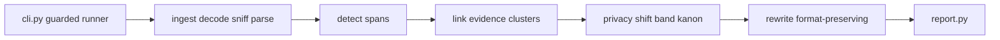

# Architecture

## Components

| Component | Responsibility | Never does |
|---|---|---|
| `safety.py` | keyring (HKDF), PII-free logger, crash hooks, encrypted temp, signal-safe wipe | print values, keep the raw secret |
| `cli.py` | walk input in sorted order, SHA-256 each file, Pass A / Pass B, accounting check, exit code | write outside `{output}`, follow output into input |
| `ingest/` | decode (BOM, UTF-16, UTF-8, cp1252), detect format, parse CSV/JSON/text, depth guard | return a partially parsed file |
| `detect/` | typed spans with confidence and rule id; clinical vetoes | look at file names to choose rules |
| `link/`, `translit/` | canonical cross-script name keys, blocking, scoring, cannot-link clustering, HMAC pseudonyms | link on a name alone |
| `privacy/` | per-patient date shift, truthful age bands, location generalisation, k-anonymity escalation | alter doses, labs, vitals or LOS |
| `rewrite/` | CSV/TSV, JSON, FHIR R4, text writers; safe file names | change column count, key paths or value types |
| `report.py` | `report.json`, `records.jsonl`, counts derived from exported entries | estimate or round up counts |

## Data flow and the two passes

1. **Walk.** `os.walk` with sorted directories and files gives a stable order on every machine.
2. **Pass A (ingest).** Read bytes once (read-only), SHA-256, size limit, extension and
   content checks, decode, parse. Failures become `quarantined` with a closed-vocabulary
   reason. From S2, Pass A also extracts identity evidence for every record.
3. **Global linkage (S2+).** All evidence is linked at once, so a record in file 1 can use a
   strong ID first seen in file 190. Clusters are anchored deterministically and pseudonymised
   with HMAC.
4. **Pass B (rewrite).** Each parsed file is rewritten into memory. A file is written only
   after the whole rewrite has succeeded, so a failure quarantines it with no partial output.
5. **Report.** Records of exported files go to `records.jsonl`. Counts are recomputed from
   the exported entries. Exit code 0 requires `len(entries) == len(inputs)`.

## Security boundaries

| Boundary | Control |
|---|---|
| Input → process | opened `rb` only; the input dir is never a write target; output inside input is refused |
| Process → stdout/stderr | `SafeLogger` templates only; `argparse` errors suppressed; warnings off |
| Process → disk | only `{output}` and one lazily created `0700` AES-GCM temp dir, wiped by atexit / signal / excepthook |
| Secret → anything | read once, HKDF-expanded, raw value not stored; keyring `repr` redacted |
| Release → attacker | pseudonyms keyed (A6), per-release (A7); per-patient date shift defeats global-shift recovery (A5) |

## Determinism rules

Sorted walks everywhere; no `set` iteration in output paths; JSON keys keep input order;
`records.jsonl` lines sorted by file walk order then locator; collision handling in
`assign()` iterates anchors in sorted order; no time or randomness in `sanitized/` or
`records.jsonl` (timing lives only in `report.json`, which is excluded from the
byte-identity check).
