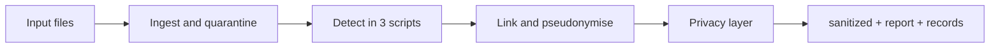

# Anamika: visible to science, invisible to attackers

**Track 3 · Secret Wards** · Team **anamika**: Aashrith M P, Rishi Navroop, Prasad A M · Repo: github.com/ampere207/Anamika

## 1. In one paragraph

Anamika is an offline, CPU-only, LLM-free privacy firewall for India's multilingual hospital exports. It removes personal data
from text, fields, JSON keys, CSV headers, file names, metadata and base64 attachments in English, Devanagari Hindi and Hinglish,
keeps every clinical value exact, gives each patient one keyed pseudonym across hospitals and scripts, and generalises the release
until a voter-list attacker can no longer single people out. The idea that sets it apart: **it learns each dataset before it
rewrites it.** Pass A reads every file, classifies fields by label *and* by their values, and turns the names it finds in structured
fields into a run-time lexicon that then finds the same people in free text, in any script. Pass B rewrites with that knowledge.

## 2. Architecture

## 3. How it works

- **Ingestion.** Formats are sniffed by content, not extension: CSV/TSV with shifted columns, nested JSON, NDJSON, FHIR R4 bundles, text.
  Encodings: UTF-8/16, cp1252, Latin-1. Broken, empty, too-deep or unsupported files (zip, xlsx, binaries) are quarantined with a
  reason and never copied; every input file is accounted for by SHA-256.
- **Detection.** Checksummed patterns (Verhoeff Aadhaar, PAN, ABHA, Indian phones in any spacing or Devanagari digits); a context
  engine for labels, relation markers (S/o, W/o, पत्नी, पुत्र), honorifics and Hinglish particles ("Arif sahab ka BP"); field
  classification that works on unseen headers by profiling values. Clinical safelists veto false hits: doses, frequencies, vitals,
  labs, eponymous diseases and "Dr." names are kept; "C/O fever" is a complaint, "C/O Ramesh" a relative.
- **Linkage and pseudonyms.** Strong IDs join first with union-find. Names are matched across scripts through transliteration,
  variant folding and a consonant skeleton, and only together with a date of birth, a village and compatible age, or a relative.
  Weak pairs pass a Fellegi–Sunter gate; every merge is checked against the whole cluster (cannot-link on conflicting IDs, sex or
  age), so links never chain into a wrong merge. Pseudonyms are `PSN-` + HMAC-SHA256 of the cluster under a run-derived key.
- **Privacy layer.** One keyed date offset per patient (intervals and length of stay stay exact; no global shift to recover); ages
  become bands that contain the true age; DOB removed; village, house, PIN removed; district raised to state. All knobs are in
  `config/policy.yaml` with three measured presets.
- **Security.** `RAKSHA_SECRET` is read from the environment only; HKDF-SHA256 derives four purpose keys (pseudonyms, date shifts,
  file names, AES-GCM temp encryption). Logs accept only whitelisted templates with counts; crashes print the exception type only.
  No network at run time, input opened read-only. If the release server is breached, no key is in it.

## 4. USP

- **Dataset-adaptive detection:** names learned from one file's fields are found in every other file and script, so canaries and
  new names are caught by context, not by lists. No model, no gazetteer of dev names.
- **We attack our own release:** a re-implementation of the published A1–A7 attacks runs on raw and release and reports risk the
  way the organisers score it. Every privacy setting was chosen on measured risk and measured clinical loss.
- **Precision-first, cross-script identity:** one pseudonym across 4 hospitals and 3 scripts, with zero false merges.

## 5. Privacy–utility trade-off (measured)

| Measure | Practice data | Untuned data (4 sets: new names, labels, formats) |
|---|---|---|
| Personal data leaked: overall / Hindi / Hinglish | 0 of 3,230 · 0 / 143 · 0 / 111 | 1 of 3,291 per set (0.03%) · 0 · 0 |
| Medical values kept | 98.1% (4,763 / 4,855) | 98.1% |
| Linking precision / recall / F0.5 · false merges | 1.00 / 0.99 / 1.00 · 0 | 1.00 / 0.97 / 0.99 · 0 |
| Length of stay exact · age bands truthful | 34 / 34 · 359 / 359 | unchanged |
| Run time · peak memory (offline, 2 CPUs, 4 GB cap) | 1.9 s · 39 MB (200 files) | 2.7 s · 39 MB (219 files); 1,245 files in 13.9 s |

Re-identification by our attacker, raw → release (balanced preset):

| Attack | Raw | Release |
|---|---|---|
| Profile re-identification (records pooled, ≥ 50% confidence) | 97.9% | 2.1% |
| Registry linkage on a voter list | 66.7% | 4.1% |
| Targeted (known visit date, hospital, rare condition) | 82.3% | 26.0% |
| Global date shift recovered by the attacker | yes | no |
| Pseudonyms reversed · pseudonyms kept under a new secret | n/a | 0 · 0 |

The three presets, measured end to end:

| Preset | Location · age band | Attack resistance | Re-identified (profile) | Clinical values kept |
|---|---|---|---|---|
| research | tehsil · 5 years | 0.612 | 89.6% | 100% |
| **balanced (default)** | **state · 10 years** | **0.916** | **2.1%** | **98.1%** |
| strict | state · 20 years, rare values suppressed | 0.920 | 2.1% | 97.4% |

**Why these settings.** Keeping a shifted DOB still reveals the birth year, and district plus sex plus a 5-year band was close to
unique against a voter list. Removing DOB, using 10-year bands and raising district to state costs 1.9% of clinical probes (only
location values; every dose, lab, vital, diagnosis and interval is kept) and cut profile re-identification from 90% to 2%. A
`research` preset keeps tehsil and 5-year bands (100% clinical values, 90% re-identifiable) for internal use; `strict` adds
rare-value suppression, which we measured and found not to lower the targeted attack, so it is opt-in.

## 6. Known limitations

- The targeted attack still succeeds for 26% of targets: visit date and hospital narrow the pool even after per-patient shifts.
  Next: coarser admission dates for rare diagnoses only, measured against utility.
- A quarantined binary whose *file name* holds a person's name is never exported, but its original name is what a scorer sees
  when `output` is null (the one item in the untuned sets).
- Detection is rules plus context: a bare name with no label, relation, honorific or structured anchor anywhere in the dataset
  can be missed. A small CRF trained on generated data is the next step if it beats the rules on held-out sets.
- No k-anonymity guarantee is claimed; privacy is measured empirically with the attacker above.
