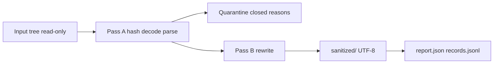

# Stage 0: Recon & scaffold

**Anamika (अनामिका)**: *Visible to science, invisible to attackers.* · Track 3 "Secret Wards" · Stage overview

## 1. Stage goal & outcome

Goal: understand the contract and the data, stand up a safe repository skeleton, reproduce the
starter baseline through our own pipeline, and build the measuring instruments we will use for
every later stage. **Outcome: done.** The pipeline runs end-to-end, prints CONTRACT OK, and matches
the starter's self-check numbers exactly. The leak scanner and the determinism checker are both in place.

## 2. What was built

- `docs/CONTRACT_NOTES.md`: exact contract, answer-key format, scorer formulas, 8 conflicts with CLAUDE.md resolved in favour of the toolkit.
- `docs/DATA_INVENTORY.md`: 200 files / 48 patients / 3,234 PII mentions, broken down by folder, type, script and hiding place, plus every trap observed.
- `anamika/safety.py`: whitelisted PII-free logger, content-free crash hooks, HKDF-SHA256 keyring (5 sub-keys), lazily created AES-256-GCM encrypted temp directory that is wiped at exit.
- `anamika/cli.py`: guarded two-pass runner (Pass A parse, Pass B rewrite) with accounting check and exit codes.
- `anamika/ingest/`: BOM / UTF-16 / UTF-8 / cp1252 decoding, linear-time JSON depth guard, record-pointer discovery, CSV round-trip.
- `anamika/report.py`: `report.json` and `records.jsonl`, with counts recomputed from what was actually exported.
- `anamika/link/pseudonym.py`, `privacy/dates.py`, `privacy/ages.py`: HMAC pseudonyms with deterministic collision handling, per-patient shifts, truthful bands (ready for S1/S2).
- `tools/leak_scan.py`, `tools/determinism.py`, `tools/md2pdf.py`; 51 unit tests.
- `raksha.toml`, pinned `requirements.txt`, `config/policy.yaml`, `.claude/settings.json` (attribution off).

## 3. How it works

- **Fail-safe by construction.** A parser either fully understands a file or raises `QuarantineError` with a reason from a closed vocabulary. Nothing is ever partially written, and exceptions never carry file content.
- **No side channel can carry PII.** The logger accepts only typed template fields: integers, short identifiers, SHA prefixes. Uncaught exceptions print only their class name and the current stage.
- **Keys kept away from data.** `RAKSHA_SECRET` is read once and HKDF-expanded into independent `pseudo`, `shift`, `file`, `enc` and `record` keys. Pseudonyms are HMACs, not hashes, so attacks A6 and A7 fail.
- **Measure like the scorer.** The leak scanner derives the official key types (identifying name tokens, digit cores across separators, exact text, DOB in any format), decodes base64 / `\u` / HTML / %-escapes, and applies the "allowed inside preserve-probe" rule.

## 4. Results (practice data, pristine LF copy of the kit)

| Metric | Starter | Anamika S0 |
|---|---|---|
| `validate_output.py` | CONTRACT OK | CONTRACT OK |
| PII still visible (`check_dev`) | 84.1% (2,718 / 3,230) | 84.1% (2,717 / 3,230) |
| PII leaked, latin / deva / hinglish | 82.8 / 100 / 100% | 82.8 / 100 / 100% |
| Canaries found | 4 / 4 | 4 / 4 |
| Medical values kept | 100% (4,855) | 100% (4,855) |
| Linking F0.5 | 0.00 | 0.00 |
| Raw copies of broken files | 0 | 0 |
| Leak scan (scorer-style) | n/a | 84.9% mentions, 96 side-channel hits |
| Determinism (same secret) | n/a | 195 / 195 files identical |
| Secret written anywhere / temp leftovers | n/a | 0 / 0 |
| Runtime / peak RSS | n/a | 0.22 s / 29.6 MB |
| Files sanitized / quarantined | n/a | 194 / 6 |

Estimated official score is about 8 / 100, the kit's stated starter level. `check_submission.py --run`
passes every run check. The README was its one failure and is now added.

## 5. Tests added

51 unit tests:
- the logger rejects free text, phones, unknown templates and boolean or string numerics;
- a crash in a subprocess prints no record content;
- keyring sub-keys are distinct, deterministic, secret-dependent and redacted in `repr`;
- the encrypted temp dir is `0700`, holds ciphertext only, and is gone after wipe;
- decoding covers UTF-8, BOM, UTF-16, cp1252, binary, undecodable and empty input;
- a 1,500-deep JSON is quarantined, and brackets inside strings are ignored;
- truncated JSON is quarantined, and record pointers are escaped per RFC 6901;
- quoted CSV newlines round-trip;
- pseudonyms resist MD5/SHA prefix inversion and are collision-free for 3,000 anchors;
- shifts stay in range, preserve LOS, and change with the secret;
- age bands contain the true age, and the Verhoeff checksum works.

## 6. Known gaps & risks

- Detection is starter-level. Names, MRNs, addresses, Devanagari and Hinglish all leak. Penalties alone are about −37 (leaks capped at −25, plus 4 canaries at −3).
- File names, JSON keys, headers, metadata and base64 are not cleaned yet.
- There are no pseudonyms, date shifts or bands yet, so identity scores 0 and privacy is weak.
- `corrupt_bytes_note.txt` is decoded through cp1252 rather than quarantined. `mislabeled_export.csv` is treated as CSV.
- **Toolkit copy on disk has CRLF line endings** (172 dev files), so its SHA-256s do not match the truth. All measurements use a pristine `git archive` copy.

## 7. Next stage plan (S1: valid end-to-end with real protection)

1. **Structured-column classifier** (EN / Hindi / Hinglish header synonyms plus value profiling) that replaces names, IDs, phones, addresses, villages and PINs. Expect detection 0→0.5, leaks −25→≈−10, about **+20 pts**.
2. **Hidden channels**: rename PII file names (HMAC), clean JSON keys, CSV headers, export metadata, and base64 attachments re-encoded. That removes the canary paths (**+6 to +12** in penalties) and the 48 file-name leaks.
3. **Text detectors**: label context (`Name:`, `नाम:`, `Attendant`, `S/o`, `W/o`, `C/O <name>`), Indian ID patterns with label context (UHID, IPD, ABHA, PAN, policy), and Devanagari digits, with dose / vital / doctor vetoes. **+5 to +8**.
4. **Quasi-identifiers**: per-record date shift (per-patient once S2 links), 5-year age bands, PIN to 3 digits, village / house / locality removed, district kept. Privacy and A5 improve, **+5 to +8**.
5. **Strong-ID pseudonyms written inside each record** (pulled forward from S2): identity moves from 0 and secret rotation becomes testable. **+5 to +8**.

## 8. Q&A nuggets

- **Why HMAC rather than SHA-256 of the UHID?** Anyone can hash a UHID list and invert a plain hash (attack A6). An HMAC under a per-release secret cannot be recomputed without the key, and a new secret makes every pseudonym change (A7).
- **How do you know no PII reaches logs?** Logging is not free-form. Every message is a whitelisted template whose fields are type-checked (integers, short identifiers, SHA prefixes). Crash handlers print only the exception class and stage. Both are unit-tested with names and phone numbers.
- **What happens with a file you cannot parse?** It is quarantined with a closed-vocabulary reason, listed by SHA-256 in the report, and never copied. The run exits 0 only if every input is accounted for.
