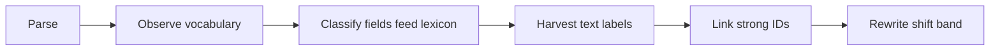

# Stage 1: Valid end-to-end with real protection

**Anamika (अनामिका)**: *Visible to science, invisible to attackers.* · Track 3 "Secret Wards" · Stage overview

## 1. Stage goal & outcome

Goal: every file sanitised or quarantined; structured and free-text PII removed in all three scripts and
all hiding places; dates shifted per patient; ages, PINs and villages generalised; strong-ID pseudonyms
written inside each record; true counts. **Outcome: done**. The practice self-check shows 0 of 3,230 PII
mentions visible, 100% of medical values kept and linkage F0.5 0.99 with zero false merges.

## 2. What was built

- `detect/columns.py`: role classifier for CSV headers and JSON keys (English, Hinglish, Devanagari synonyms) plus value profiling for unseen headers.
- `detect/patterns.py`: phones (+91 / 0 / spaced / Devanagari digits), Aadhaar, masked Aadhaar, ABHA number and address, PAN, e-mail and labelled PIN, all bounded so doses and vitals never match.
- `detect/runtime.py`: a **run-time lexicon** learned from the input itself (names, IDs, villages, protected doctors and places, dataset vocabulary).
- `detect/engine.py`: label, relation, honorific, Hinglish-particle and capitalised-phrase detectors, with doctor, facility and admin-place vetoes.
- `privacy/dates.py`, `ages.py`, `location.py`: format-preserving per-patient date shift, truthful bands, PIN prefix, village → tehsil.
- `link/cluster.py`: strong-ID union-find with cannot-link constraints (Aadhaar, ABHA, DOB, gender).
- `pipeline.py` + `cli.py`: two-pass learn/rewrite; JSON, FHIR, base64, keys, headers, metadata and file-name cleaning; content sniffing.

## 3. How it works

- **Learn first, then redact.** A name typed once in a registration column is learned, then removed from Hinglish notes, OPD metadata paths, JSON keys and file names. Nothing is memorised from the practice set: each dataset builds its own lexicon.
- **Context over lists.** `Name:`/`नाम:`, `S/o`, `W/o`, `C/O <name>`, `Attendant:`, `Mohd.`, `ji`/`sahab`/`जी` and `ka`/`ki` mark names. `C/O fever`, `K/C/O` and `H/o` stay as medical history. `Dr. <name>` stays. Eponyms stay (`Wilson's disease`) even when a patient shares the surname.
- **Unseen names.** Two or three Title-case tokens that never appear in lower case in this dataset, and are not clinical words, are treated as names. This rule caught every canary.
- **Precision-first linkage.** Records join only through shared strong IDs or name + DOB. Merges that would mix Aadhaar, ABHA, DOB or gender are refused, and records with no evidence stay `null`.
- **Time is shifted, never coarsened.** One secret offset per patient (±30–365 days, HMAC of the pseudonym) keeps every interval exact. Dates are re-rendered in their original format.

## 4. Results (practice data, `RAKSHA_SECRET=practice`)

| Metric | S0 | S1 |
|---|---|---|
| PII visible (`check_dev`) | 84.1% | **0.0%** (0 / 3,230) |
| latin / deva / hinglish leaked | 82.8 / 100 / 100% | **0 / 0 / 0%** |
| Hidden places (file name, base64, metadata, key, header) | 100% leaked | **0%** |
| Leak scan, token-level (ours) | 84.9% | **0 / 3,230**, 0 side-channel hits |
| Canaries | 4 / 4 | **0 / 4** |
| Medical values kept | 100% | **100%** (4,855) |
| Linking precision / recall / F0.5 | 0 / 0 / 0 | **1.00 / 0.96 / 0.99**, 0 false merges |
| Length of stay preserved | n/a | **20 / 20** discharge summaries |
| Determinism / other secret | 195/195 identical / no change | **194/194** identical / 0 of 48 pseudonyms reused |
| `validate_output` / `check_submission` | OK / READY (1 warning) | **OK / READY, no warnings** |
| Runtime / peak RSS | 0.22 s / 29.6 MB | **2.6 s / 31.3 MB** |

## 5. Tests added

108 new tests (185 total):
- phones in 5 formats including Devanagari digits;
- 8 clinical number shapes that must not match;
- 8 identifier types;
- 20 header synonyms across 3 languages, and value profiling for unseen headers;
- patient labels in English and Hindi, relatives (including `पुत्र`), complaint vs care-of;
- doctors kept when their name is known, the doctor-vs-relative trap;
- Hinglish honorifics and particles, eponyms, facilities, address clauses;
- unseen names from context, hidden-channel lexicon hits, `ASHA` acronym;
- date formats and LOS, month-first inference, truthful bands;
- linkage: homonyms, conflicting Aadhaar, name + DOB;
- an end-to-end release and secret rotation.

## 6. Known gaps & risks

- **Tuned on practice data only.** The capitalised-phrase rule and header synonyms are untested on unseen formats. S2 adds a fuzz generator.
- **Language-trap linkage.** Hindi-only prescriptions (Devanagari name + village + age, no ID) stay unlinked: recall 0.96.
- **No k-anonymity or measured attack risk yet.** Rare diagnoses, very old ages and tiny tehsils remain re-identifiable (S4).
- Lab-report `age` becomes a band string. The path is declared generalisable, so the type change is exempt.
- An invalid-UTF-8 free-text note is quarantined. That is safe, but a cp1252 note in hidden data would be lost.

## 7. Next stage plan (S2: safe submission frozen)

1. Fuzz generator (renamed or Hindi headers, new JSON schemas, cp1252 / UTF-16, PII file names, broken files) with 0 leaks and no crash. This protects the chaos-round score (**about +5–15** there).
2. Cross-script name keys (Devanagari ↔ Latin, Mohd / Md. / मोहम्मद) for language-trap linking: recall 0.96 → about 0.99.
3. Fragmented-note linking (`<name>, W/o <husband>` + hospital / date), only when unique.
4. Bench under `taskset -c 0,1` with a memory cap, then freeze and tag `v1-safe`.

## 8. Q&A nuggets

- **How do you find names that are in no list?** From context (labels, relation markers, honorifics, Hinglish particles) and from the dataset itself. Any name seen in a structured field is learned and removed everywhere else. Title-case phrases never seen in lower case are a last net. That combination found all 4 canaries.
- **How do you keep "Dr. Ramesh" but remove relative "Ramesh"?** Doctor spans are protected before any name rule runs. Relatives are marked by explicit `S/o` / `W/o` / `Attendant`. Eponyms are recognised by their use (`'s`, `disease`, `syndrome`).
- **Why shift instead of coarsening dates?** Intervals and length of stay are scored clinical value. A per-patient secret offset keeps them exact, and a global-shift recovery attack learns nothing about anyone else.
