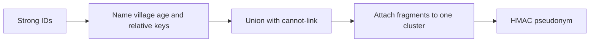

# Stage 2: Safe submission frozen

**Anamika (अनामिका)**: *Visible to science, invisible to attackers.* · Track 3 "Secret Wards" · Stage overview

## 1. Stage goal & outcome

Goal: prove the pipeline holds on data it was never tuned on, close the language-trap and fragmented-identity
linkage gaps, confirm it runs within the evaluation budget, and freeze a safe version. **Outcome: done.**
Three fuzzed "never-seen" variants show 0 leaks, 0 canaries and 100% medical values kept. Dev linkage reaches
F0.5 1.00 with zero false merges, and the release is tagged `v1-safe` locally.

## 2. What was built

- `tools/fuzz_gen.py` turns the practice set into unseen variants, each with its own answer key: 181 invented names in Latin and Devanagari, 54 renamed headers and keys, new free-text labels, re-formatted DOBs, UTF-16 / cp1252 re-encodings, hostile files (zip, xlsx, NDJSON, truncated JSON, a binary with a PII file name, a Devanagari file name) and three **novel templates** (a nested EMR JSON, a CSV with unseen headers, a pipe-delimited OPD slip).
- `tools/bench.sh`: runs under `taskset` with 2 CPUs and a 4 GB `ulimit`, measuring wall time and peak RSS.
- `detect/columns.py`: token-based header rules (`<pt|hosp|reg|ip…>` + `<id|no|ref>` → ID, `<mob|cell|call…>` → phone) and **value profiling for name and address columns**.
- `translit/keys.py`: cross-script phonetic keys (Devanagari → ITRANS → folded → consonant skeleton).
- `link/cluster.py`: name + village (age ±2), name + relative, and **unique-only** fragment keys. Age checks apply to weak evidence only.
- `detect/engine.py`: the subject of `<name>, W/o <husband>`, and colon-tolerant context verbs (`Accompanied by:`).

## 3. How it works

- **Generalise by shape, not by name.** A column of 1–4 capitalised or Devanagari tokens that are never ordinary words in this dataset is a name column, whatever its header says. The same idea finds address columns from house, ward and tehsil cues.
- **One person, three scripts.** `मोहम्मद शाहिद`, `Mohd. Shahid` and `Shahid` all fold to the key `shd`. A key links records only together with a village and a compatible age, or a relative's name.
- **Fragments attach, they never bridge.** `Meera, W/o Rajan` can only join the single cluster that already carries that first-name + relative pair. If two clusters carry it, the note stays on its own.

## 4. Results

| Dataset | PII visible (check_dev) | Leak scan (ours) | Canaries | Medical kept | Link P / R / F0.5 · false merges | Contract |
|---|---|---|---|---|---|---|
| Practice (S1) | 0.0% | 0 / 3,230 | 0/4 | 100% | 1.00 / 0.96 / 0.99 · 0 | OK |
| **Practice (S2)** | **0.0%** | **0 / 3,230** | **0/4** | **100%** | **1.00 / 0.99 / 1.00 · 0** | OK |
| Fuzz 7 / 8 / 9 before S2 fixes | 2.2% (deva 7.6%) | 152 / 3,232 | 0/4 | 100% | 1.00 / 0.25 / 0.63 · 0 | OK |
| **Fuzz 7 / 8 / 9 (S2)** | **0.0%** (a) | **0 / 3,248** | **0/4** | **100%** | **1.00 / 0.97 / 0.99 · 0** | OK |
| Novel templates (×3) | n/a | **0 / 16 entities** | n/a | **8 / 8** | n/a | OK |

(a) One item counted by `check_dev` is a quarantined, never-exported file whose *input* name it reads. Our scanner checks the real output names: 0.

| Bench (2 pinned CPUs, 4 GB cap) | Files | Wall | Peak RSS |
|---|---|---|---|
| Practice set | 200 | 2.6 s | 43 MB |
| Combined 6.2× set | 1,245 | 20.4 s | 63 MB (growth exponent ≈ 1.13) |

Determinism: 194/194 files identical; a rotated secret reuses 0 of 52 pseudonyms. Lengths of stay: 20/20.
`check_submission --run`: READY TO SUBMIT. Tests: 224.

## 5. Tests added

39 new tests:
- 15 unseen header variants, and non-identifier headers left alone;
- name, relative and address columns found from values alone, and clinical columns rejected;
- six Latin ↔ Devanagari name pairs, plus place and first-name keys;
- a Hindi record linking by name + village + age, and a mother and daughter with the same name kept apart;
- strong IDs that ignore age noise;
- fragments attached only when unambiguous.

## 6. Known gaps & risks

- The fuzz variants reuse practice templates; only three novel templates are truly new. The organisers' chaos round can still surprise.
- Phonetic skeletons can collide for short names. Every weak key therefore needs a second clue and passes the cannot-link checks.
- **No k-anonymity or measured attack risk yet** (S4): rare diagnoses and 90+ ages are still near-unique.
- Growth is close to the 1.15 scaling threshold; the lexicon regex alternations grow with the dataset.

## 7. Next stage plan (S3: detection & meaning traps hardening)

1. Run more novel templates (XML-like text, scanned-form OCR text, mixed-script lines) and add 10+ template shapes to the fuzz set. Expected: chaos-round leak resistance.
2. Audit precision on the clean documents and meaning-trap probes. Aim to keep 100% under fuzz.
3. A `--debug-spans` export for the console (outside `{output}`).
4. Lexicon matcher speed-up (token index instead of alternations) to keep the growth exponent ≤ 1.1.

## 8. Q&A nuggets

- **How do you know it works on formats you have never seen?** We built a generator that replaces every name, renames headers, keys and labels, re-encodes files and adds new templates, with its own answer key. Before the S2 fixes it exposed a 0.25 link recall and a 2.2% leak. After them: 0 leaks and 0.97 recall on all three variants.
- **How do you link a Hindi prescription to an English registration?** Names in both scripts fold to the same phonetic key. A link also needs the same village key and an age within two years, and it never overrides a conflicting identifier.
- **What if a fragment matches two patients?** It stays on its own pseudonym. Fragment keys may only attach to the one cluster that already carries them; they can never bridge two people.
