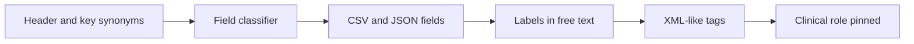

# Stage 3: Detection & meaning-trap hardening

**Anamika (अनामिका)**: *Visible to science, invisible to attackers.* · Track 3 "Secret Wards" · Stage overview

## 1. Stage goal & outcome

Goal: make detection and precision hold on shapes we have never seen, measure utility the way the scorer
does, add an explainability export for the console, and keep the pipeline linear in cost. **Outcome: done.**
Thirteen novel templates show 0 leaks and keep every clinical value. Token retention is 99.66% (100% on clean
documents), and the 6× dataset runs 40% faster.

## 2. What was built

- `tools/utility_check.py`: preserve-probes by kind, plus token retention overall and on clean documents (the over-redaction detector).
- `tools/fuzz_gen.py`: 10 more novel shapes: XML-in-text, an ALL-CAPS register, a referral letter, an SMS with `contact son …`, a mixed-script line, Hinglish `Mareez ka naam -` labels, a headerless CSV, Devanagari headers, a JSON of positional `columns` + `rows`, and an insurance claim with unseen keys.
- `detect/engine.py`: **any label the field classifier knows also works in text** (`label: value`, `label - value`, `| label: value |`, `<tag>value</tag>`); `resident of` / `r/o` / `निवासी`, kinship words (`son`, `wife`, `बेटा`) and `मरीज़ <name>`; explicit labels outrank guesses; a token-indexed lexicon matcher.
- `detect/columns.py`: a `clinical` role pins diagnosis / complaint / drug / test columns (`निदान`, `Dx`…) so they are never profiled as names. Devanagari category columns are guarded.
- `detect/patterns.py`: voter ID (EPIC), landlines with STD code, masked mobiles (`98XXXXXX10`).
- `pipeline.py`: JSON `columns` + `rows` tables, and district-level `city` values kept.
- `cli.py --debug-spans DIR`: value-free span, role and rule explanations, named by SHA prefix, refused inside output or input.

## 3. How it works

- **One vocabulary, every channel.** The same classifier that reads `Gaon`, `Sampark no` or `Hospital No` as CSV headers now reads them as text labels and XML tags. Every synonym added for one format helps all of them.
- **Precision is pinned, not hoped for.** Clinical headers (`Diagnosis`, `निदान`, `Drug`, `Test`) are a role of their own. Repeated Devanagari words are categories, not people. Explicit labels decide the type over heuristic guesses.
- **Linear by construction.** Lexicon lookups are set membership on tokens instead of ever-growing regex alternations, and header classification is cached.

## 4. Results

| Metric | S2 | S3 |
|---|---|---|
| Practice: PII visible · leak scan · canaries | 0% · 0 · 0/4 | **0% · 0 · 0/4** |
| Practice: link P / R / F0.5 · false merges | 1.00 / 0.99 / 1.00 · 0 | **1.00 / 0.99 / 1.00 · 0** |
| Preserve-probes kept (dev / fuzz) | 100% / 100% | **100% / 100%** (4,855 / 4,863) |
| Token retention (all / clean docs) | not measured | **99.66% / 100%** |
| Fuzz ×3: leaks · medical · F0.5 · false merges | 0 · 100% · 0.99 · 0 | **0 · 100% · 0.99 · 0** |
| Novel templates | 3 shapes, 0 / 16 leaked | **13 shapes, 0 leaks, all probes kept** |
| Bench 200 / 1,245 files (2 CPUs, 4 GB) | 2.6 s / 20.4 s | **2.3 s / 12.1 s** (exponent ≈ 0.91), 58 MB |
| Determinism · rotation · READY TO SUBMIT | yes · 0 reused · yes | **yes · 0 / 52 reused · yes** |

Bugs found and fixed this stage:
- the utility tool double-counted `\u`-escaped JSON;
- districts in FHIR `city` were replaced;
- a Devanagari diagnosis column was profiled as names;
- an f-string turned the regex quantifier `{2,}` into the literal text `(2,)`, so label values ran across column gaps and split 12 patients' links (a repo-wide scan found no other instance).

## 5. Tests added

38 new tests (262 total):
- kinship and `मरीज़` names;
- 8 unseen label shapes, including tags and `|` segments, and 6 non-PII labels left alone;
- column-gap stopping;
- new ID patterns, and codes they must not hit;
- possessives, and IDs embedded in file names;
- clinical header pinning and the Devanagari category guard;
- JSON tables end to end;
- the debug export (value-free, refused inside output).

## 6. Known gaps & risks

- **Re-identification risk is still unmeasured.** No k-anonymity escalation yet: rare diagnoses, 90+ ages and small tehsils (S4).
- Novel templates are ours. The organisers' chaos catalogue (labels, name pool, ID and date formats) is sealed and can still differ.
- `--debug-spans` exposes offsets and rule ids. They contain no values, but they belong to the demo machine, not a shared release.

## 7. Next stage plan (S4: linkage & privacy push)

1. `tools/attacker.py`: our own A2–A5 attacker (registry linkage, profile pooling, targeted known facts with shift recovery), run on raw vs release. Report risk ratios. This is the **25-point** category.
2. k-anonymity escalation on (age band, gender, district, diagnosis category), for rare records only: widen bands, suppress rare diagnoses while keeping the ICD chapter.
3. Policy presets (Strict / Balanced / Research), with the measured privacy-utility curve.
4. Linkage: Fellegi–Sunter scoring for the remaining weak pairs, with precision first.

## 8. Q&A nuggets

- **What if the hidden data uses a label you've never seen?** Any label our field classifier knows works in every channel: headers, JSON keys, text labels, XML tags. Unknown labels fall back to value shape (names, IDs, phones, addresses) and the run-time lexicon. Thirteen invented formats showed 0 leaks.
- **How do you prove you don't over-redact?** We measure what the scorer measures. All 4,855 preserve-probes are kept, 99.66% of non-PII words survive, and 100% on clean documents. Clinical columns have a pinned role so a name heuristic can never touch them.
- **Will it scale?** On two pinned CPUs: 2.3 s for 200 files, 12 s for 1,245, under 60 MB. Cost grows linearly because lexicon lookups are set membership, not regex alternations.
