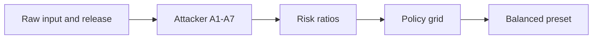

# Stage 4: Privacy push & backend completion

**Anamika (अनामिका)**: *Visible to science, invisible to attackers.* · Track 3 "Secret Wards" · Stage overview

## 1. Stage goal & outcome

Goal: measure and reduce re-identification risk (25 points), finish linkage, and complete every
backend capability the console needs. **Outcome: done.** Our implementation of the published attacker
shows resistance rising from 0.627 to **0.914**, and profile re-identification falling from 98% to **2%** of patients.
The release still has 0 leaks and F0.5 1.00, and every feature is available through the FastAPI service.
That was verified end to end in Docker.

## 2. What was built

- `tools/attacker.py` implements A1–A7 as published, on raw vs release: registry linkage with filters and name weights, profile pooling through in-data pseudonyms and shared references, targeted known facts with global-shift recovery, pseudonym inversion and cross-release linkage.
- Policy knobs `location.level`, `ages.dob_policy`, `kanon.rare_k`, and three measured presets: `research`, `balanced` (default), `strict`.
- `privacy/kanon.py`: rare condition / procedure text → ICD chapter, with codes kept.
- `link/cluster.py`: a Fellegi–Sunter gate on weak merges; evidence-typed edges and kept-apart pairs.
- `--debug-spans` writes `linkage.json`, a value-free identity graph.
- A fix: FHIR `meta.lastUpdated` carried unshifted discharge dates.
- API: job options `policy`, `explain`, `utility`, `attack`; endpoints `/explain`, `/explain/{key}`, `/graph`, `/policy/presets`, `/policy?preset=`; a demo-only `/compare` that is refused in production.

## 3. How it works

- **Measure, then decide.** Two grids (13 settings) were each scored on attack resistance, leaks, preserve-probes, token retention and linkage. The default was picked from the numbers, not intuition.
- **The surprise.** Village, tehsil and PIN were not the fingerprint. Pooling a patient's records through their pseudonym left district + gender + 5-year band + **birth year** (a shifted DOB still reveals it), which was unique for 25 of 37 identified patients.
- **Balanced default.** State-level location, 10-year bands, no PIN, DOB removed (FHIR `birthDate` is optional in R4). Doses, labs, vitals, diagnosis codes, intervals and LOS are untouched.

## 4. Results (practice data)

| Preset | Resistance (≈ /25) | A2/A3 | A4 | A5 | A1 · A6 · A7 | Medical kept | Retention | Leaks · F0.5 |
|---|---|---|---|---|---|---|---|---|
| research | 0.627 (15.7) | 0.28 | 0.91 | 0.65 | 0.02 · 0 · 0 | 100% | 99.7% | 0 · 1.00 |
| **balanced** | **0.914 (22.8)** | 0.06 | **0.02** | 0.33 | 0.02 · 0 · 0 | 98.1% | 97.4% | 0 · 1.00 |
| strict | 0.917 (22.9) | 0.04 | 0.02 | 0.33 | 0.02 · 0 · 0 | 97.4% | 97.2% | 0 · 1.00 |

- **Balanced, absolute rates:** registry probability on the true person 66.7% → 4.1%; profiles re-identified 98% → 2%; targeted attack 82% → 27%; direct exposure 100% → 2%.
- **Fuzz ×3:** 0 leaks, F0.5 0.99, 0 false merges. 13 novel templates with 0 issues.
- **Bench:** 2.5 s / 41 MB for 200 files; 13.9 s / 59 MB for 1,245.
- **Determinism:** 194/194 identical, 0 of 53 pseudonyms reused under a new secret.
- **Docker E2E** (one API job with every option): resistance 0.916, 0 leaks, 4,763/4,855 probes, 192 explained files, an 877-node graph with 9 kept-apart pairs.
- **Checks:** READY TO SUBMIT; 269 tests.

## 5. Tests added

- presets listed, selected and rejected when unknown;
- explain, graph and compare: value-free, owner-only, 403 outside demo mode, refused in production;
- utility and attack need an answer key;
- the balanced default removes tehsil, district, PIN and DOB while doses, vitals and doctors survive;
- research-preset assertions kept for tehsil / PIN-prefix behaviour;
- the debug export includes a value-free `linkage.json`.

## 6. Known gaps & risks

- The attacker is ours, built from the published method; the organisers' code is sealed. A5 is noisy (date coincidences across pooled profiles) and still succeeds about 27% of the time.
- Balanced gives up district and DOB detail (about 1 utility point by our estimate). `research` exists for internal studies.
- The attacker takes about 2 minutes per run. That is fine for verification jobs but slow for live demos; the console should use cached results.
- Removing FHIR `birthDate` lowers JSON key-path overlap (0.987 → 0.952 mean). `birthDate` is a declared generalisable path.

## 7. Next stage plan (S5: console, Next.js)

1. **Agree your frontend strategy first**, as you asked.
2. Screens on the finished API: overview, redaction studio (`/compare` + spans), identity graph (`/graph`), attack simulator (presets + `attack`), clinical integrity (`utility`), security & audit (verification).
3. Docker service for the frontend, CORS already scoped to its origin.

## 8. Q&A nuggets

- **How do you know the release resists the attacker?** We implemented the published attacks and ran them on raw and released data. Profile re-identification falls from 98% to 2%, the targeted attack from 82% to 27%, and resistance is 0.914.
- **Isn't removing DOB and district too much?** We measured it. A shifted DOB still reveals the birth year, and district + gender + band was near-unique. Removing both costs about 1 utility point and buys about 7 privacy points, with every clinical value untouched.
- **Why not suppress rare diseases?** We built and measured it: no gain against this attacker, at a cost in clinical value. So it is opt-in (`strict`) and keeps ICD codes.
