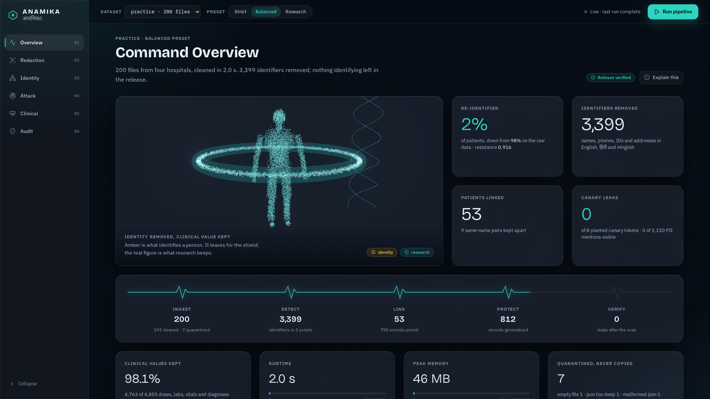
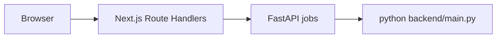

# Stage 5: Anamika Console

## 1. Stage goal & outcome

Done. Six screens of a Next.js console show one live pipeline run: detection, linkage, our own attack, clinical utility and
the security audit. Every number comes from a real job on the FastAPI service; nothing is mocked. Two backend defects found
while building the screens were fixed with tests.

## 2. What was built

- `dashboard/` · Next.js 15 App Router, React 19, TypeScript strict, Tailwind v4 tokens, offline fonts (Bricolage Grotesque,
  IBM Plex Sans/Mono, Tiro Devanagari Hindi, Noto Sans Devanagari).
- `dashboard/src/lib/server/anamika.ts` · server-only API client. The API key and URL never reach the browser; Route Handlers
  under `app/api/*` proxy every call.
- Screens: `overview` (Dissolving Identity 3D hero), `redaction`, `identity`, `attack`, `integrity`, `audit`, each with an
  "Explain this" drawer, loading skeleton and error state.
- `dashboard/scripts/demo.mjs` · `npm run demo` starts FastAPI and the console together.
- Backend fix · `anamika/detect/engine.py`: relative labels ending in a bare name label.
- Backend fix · `app/services/runner.py`: leak-scan side channels no longer include rerun releases.
- Docs: `DESIGN_SYSTEM.md`, `DEMO_SCRIPT.md`, this report, 16 screenshots in `s5_screens/`.

## 3. How it works

- **The browser never talks to the pipeline.** Server components and Route Handlers call FastAPI with a server-side key.
  Originals are served only when `ANAMIKA_ALLOW_ORIGINALS` is set, which production refuses.
- **One run, two jobs.** An evidence job (release, value-free span explanations, leak scan, clinical probes, determinism and
  rotation reruns) and an attack job (A1 to A7 on raw and release). Screens read whichever finished.
- **Charts follow a validated palette.** Brand teal is for state; data uses colour-blind-checked slots. Raw vs release is
  orange vs blue, every chart has a legend or direct labels, and two have a table view.
- **Honest numbers over flattering ones.** Kept-apart pairs that stronger evidence later joined are not counted as refused
  merges (9 record pairs → 5 patient pairs). Deliberate losses such as district → state are labelled as policy where they appear.
- **Fails soft.** No WebGL: static figure. Reduced motion: final values, no scan line. Backend down: a clear empty state.

## 4. Results

| Check | Result |
|---|---|
| `npm run build` | clean: 0 warnings, lint and types pass, 103 kB shared JS |
| Screen load, production build | 186–345 ms per screen; first paint ≤ 0.2 s where measured |
| Hydration errors (production) | 0 |
| Console messages | one upstream `THREE.Clock` deprecation from React Three Fiber 9.8.2 (latest) |
| Hero FPS | 11–12 fps under CPU software rendering (SwiftShader); real-GPU FPS not measured here |
| Fallbacks | no-WebGL → static figure, reduced motion → still frame, both verified |
| Pipeline after fixes (practice, balanced) | 0 / 3,230 leaks, 0 canaries, link F0.5 1.00, 0 false merges, medical 98.1%, LOS 34/34, age bands 359/359 |
| Hindi relative labels | 10 / 10 `[RELATIVE]` (3 `पति का नाम` lines previously carried the patient's pseudonym) |
| Leak-scan side channels in jobs | 47 false hits → 0 |
| Tests | 274 passing |

## 5. Tests added

- `test_relative_label_ending_in_name_is_relative`: `पति का नाम`, `पिता का नाम`, `Husband Name`, `Father's Name`.
- `test_patient_label_still_works_next_to_relative`: patient and husband lines in the same note.
- Every screen was screenshotted at 1440 × 900 and 1920 × 1080, plus reduced motion and a Hindi document.

## 6. Known gaps & risks

- Hero FPS on a GPU is unmeasured. An adaptive-quality variant rendered blank under software GL and was reverted.
- The `THREE.Clock` warning is upstream and harmless; it will go when React Three Fiber moves to `THREE.Timer`.
- Starting a run takes about 60 s with the attack and the reruns, so the demo pre-runs.
- The first page in a cold browser on `next dev` hydrates slowly. The production build does not.
- No k-anonymity histogram: the attack job does not export equivalence classes. The trade-off chart covers the same question.

## 7. Next stage plan (S6: docs, brief and pitch)

- Two-page brief PDF from the toolkit template, with the attack and utility numbers from this console.
- Architecture diagram for README, brief and pitch.
- Backup screen recording of `DEMO_SCRIPT.md`.
- Expand `QA_PREP.md` to 30 questions and rehearse the five-minute flow.

## 8. Q&A nuggets

**Q: Is the console showing real data or a mock-up?**
Real. Every screen reads a live job: press Run pipeline and the numbers come from that run. The browser never sees the
API key; originals are shown only in local demo mode on synthetic data.

**Q: Your first count said 9 wrong merges refused, now 5. Why?**
Nine record pairs were refused on weak evidence. Four of them were later joined by a strong ID, so they are one person
correctly. Five patient pairs stayed apart. We show the honest number.

**Q: What did building the console find?**
Two bugs. A Hindi husband's-name line took the patient's pseudonym, now fixed with tests and no score regression. And
the job leak scan counted ward labels like "Ward 3" inside rerun copies as side-channel hits; reruns are now compared byte
for byte instead.
